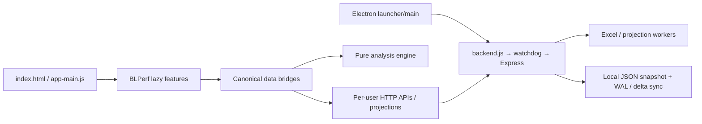

# Performans değerlendirmesi / Performance review — 2026-10-06

TR: Fiyat & Üretici Analizi'nin üretimde kullanılan veri hazırlama ve filtreleme yollarında iki tekrar işleme darboğazı ölçüldü ve giderildi. Genel masaüstü açılışı veya tüm ekranlar için hızlanma iddiası yoktur.

EN: Two measured redundant-processing bottlenecks were removed from the production Price & Supplier Analysis preparation and filtering paths. These results do not establish a faster desktop startup or faster behavior in every screen.

## Ortam ve yöntem / Environment and method

Base: `49abe1d472924b14f660b225647501d104158bc5` (fetched `origin/main`). Linux, Node 22.23.3, five available CPUs, headless Chromium. Synthetic data only; no company data or external integration credentials.

TR: Üretim motorunun eski ve yeni sürümleri aynı süreçte, ısınma turundan sonra dönüşümlü sırayla dokuz kez çalıştırıldı. Medyanlar raporlandı; hazırlanan veri ve bütün analiz çıktıları eski sürümle derin eşitlik üzerinden karşılaştırıldı. Aktif filtre senaryosu beş boyutta çoklu seçim, Türkçe normalleştirme, ham sütun filtresi, iki sezon ve birden fazla para birimi içerir. Ölçümler uçtan uca uygulama süreleri değildir.

EN: Old and new production engines ran in alternating order in one process, with warm-up and nine samples. Reported values are medians; complete prepared datasets and analysis results were checked for deep equality against the baseline. The active-filter scenario includes five filter dimensions, multiple selections, Turkish normalization, a raw-column filter, two seasons and multiple currencies. These are component timings, not end-to-end application timings.

```bash
cd /workspace/Buyer-Log-Desktop/resources/app
source /workspace/.buyer-log-tools/activate.sh
node scripts/benchmark-price-supplier.js 49abe1d 20000
```

## Başlangıç ve sonuç / Baseline and result

| 20,000 records / kayıt | Before / Önce | After / Sonra | Reduction / Azalma |
| --- | ---: | ---: | ---: |
| Data preparation / Veri hazırlığı | 138.7 ms | 56.4 ms | 59% |
| Analysis without filters / Filtresiz analiz | 57.5 ms | 49.9 ms | 13% |
| Analysis with empty filter controls / Boş filtrelerle analiz | 52.4 ms | 41.7 ms | 20% |
| Analysis with five active filters / Beş aktif filtreyle analiz | 186.7 ms | 54.9 ms | 71% |

TR: Küçük süre farkları makine yükünden etkilenir; esas kazanım büyük veri hazırlığı ve aktif filtrelerdedir. Aynı kayıt, fiyat, miktar, grup, sezonsal kıyas ve detay referansları korunur.

EN: Small timing differences depend on host load; the main gains are dataset preparation and active filters. Record membership, prices, volumes, grouping, seasonal comparisons and drilldown references are preserved.

## Doğrulanmış nedenler / Verified root causes

| Priority / Öncelik | Production path / Üretim yolu | Evidence and change / Kanıt ve değişiklik | Risk / Risk |
| --- | --- | --- | --- |
| P1 | `price-supplier-analysis.js:runAnalysis` → `price-supplier-insights-engine.js:analyze` | TR: Seçimler her satırda yeniden normalleştiriliyordu. Testte bir seçimin dönüşüm sayısı 120 → 1 oldu. Her analizde yeni hazırlanmış `Set` listesi kullanılır; boş ve bilinmeyen filtreler elenir. EN: Selected values were normalized per record. The regression test reduces 120 conversions to one. Fresh sets are prepared for each analysis; empty and unsupported filters are excluded. | Low / Düşük: no retained filter cache; changes apply immediately / kalıcı filtre önbelleği yok; değişiklik hemen uygulanır. |
| P2 | `price-supplier-analysis.js:prepare` → `price-supplier-insights-engine.js:prepare` | TR: Aynı boyut etiketleri binlerce kez normalleştiriliyordu. Hazırlık çağrısına özel, en fazla 1.024 etiketlik önbellek eklendi. EN: Repeated dimension labels were normalized thousands of times. A preparation-local cache stores at most 1,024 labels. | Low / Düşük: input and first displayed spelling unchanged; cache discarded after preparation / girdi ve ilk görülen yazım korunur; önbellek hazırlık sonunda bırakılır. |

## Mimari ve sonraki işler / Architecture and follow-up



TR: İş verisi sahipliği backend/local store'da; analiz ekranı kanonik gözlemleri kullanır. Excel/projection işleri worker'a ayrılmıştır, büyük tablolar pencereli çizilir, modüller tembel yüklenir. Bu katmanlar veya persistence formatı değiştirilmedi.

EN: Backend/local stores own business data; the analysis screen consumes canonical observations. Excel/projection work uses workers, large tables use windowed rendering and features load lazily. These boundaries and persistence formats remain unchanged.

TR: Bu ortamda P0 düzeyinde donma kanıtı bulunmadı. Backend soğuk başlatma denemelerinde HTTP hazır tespiti yaklaşık 407 ms, sunucu hazır sinyali yaklaşık 371 ms medyandı (altı örnek). 400 ms desktop hazır yoklama aralığı bazı başlangıçlarda ek bekleme yaratabilir; Windows/Electron ölçümü olmadan değiştirilmedi. Analiz ekranının ilk geçişi yaklaşık 0,7 s; lazy modül yükleme, gözlem üretimi ve DOM çizimi birlikte ölçülür. Bu toplam sürenin yalnız motor kısmı bu değişiklikle iyileştirilmiştir.

EN: No P0 freeze was established in this environment. Cold backend trials had median HTTP-ready detection around 407 ms and server-ready signal around 371 ms (six samples). The 400 ms desktop readiness polling interval can add latency in some starts; it was left unchanged pending Windows/Electron measurements. Initial analysis navigation was about 0.7 s, including lazy loading, observation preparation and DOM rendering. This change improves only its engine component.

TR: P3: Çok büyük veride motorun kalan senkron hesapları worker'a taşınmadan önce gerçek Windows profili alınmalı. Analiz görünümündeki 24 girdilik önbellek kayıt sayısıyla büyüyen modeller tutar; uzun kullanımda yalnız girdi sınırına değil bellek maliyetine de bakılmalı. Üretimde heap snapshot ve uzun süreli soak testi olmadan memory-leak yoktur denemez.

EN: P3: Profile the remaining synchronous engine work on Windows before moving it to a worker. The view's 24-entry cache holds models whose size grows with record count; assess byte cost as well as entry count in extended usage. No absence-of-leaks claim is warranted without production heap snapshots and a long soak test.

## Doğrulama ve sınırlar / Validation and limits

TR: Son adayda tam regresyon paketi bir kez çalıştırıldı: 831 dosya, 6.029 başarılı test, 64 atlanan test, 0 hata. TR/EN kapsam kontrolü ve dokuz sürüm notunun görsel doğrulaması geçti. Bağımsız son incelemede düzeltme gerektiren bulgu çıkmadı.

EN: The final candidate ran the complete regression suite once: 831 files, 6,029 passed tests, 64 skipped tests and zero failures. TR/EN coverage and visual validation of the nine release notes passed. The independent final review found no actionable issue.

TR: 47 hedefli test geçti. Regresyonlar Türkçe alias'ları, çoklu/boş/bilinmeyen/ham sütun filtrelerini, değişen seçimleri, ilk etiket yazımını ve 1.024 sınırını aşan farklı etiketleri kapsar. Gerçek arayüz, repo demo Excel üreticisiyle oluşturulan 2.000 ASAS ve 3.600 LFL satırıyla çalıştırıldı. Giriş, beş analiz sekmesi, filtre, arama, sıralama, detay çekmecesi, CP/Siparişler/Overview geçişleri ve senkron Refresh doğrulandı. Filtre 1.316 güncel kaydı yalnız seçilen grubun 275 kaydına indirdi. Refresh HTTP 200 döndü (~3,4 s); yeni JavaScript sayfa hatası görülmedi. İki filtre seçimi arasında 60 tekrar hesaplama sonrası, GC ile ölçülen heap 28,65 MB → 28,73 MB oldu; bu kısa kontrol uzun süreli leak testi değildir. Sürüm notu görseli değişiklik sonrası gerçek, filtreli Buyer Log ekranından alınmıştır.

EN: 47 targeted tests passed. Coverage includes Turkish aliases, multiple/empty/unsupported/raw-column filters, changed selections, first label spelling and labels beyond the 1,024-entry bound. The actual UI ran on 2,000 ASAS and 3,600 LFL rows from the repository's demo Excel generator. Login, five analysis tabs, filtering, search, sort, the detail drawer, CP/Orders/Overview navigation and synchronous Refresh were checked. Filtering narrowed 1,316 current records to 275 from the selected group only. Refresh returned HTTP 200 (~3.4 s); no new JavaScript page errors occurred. After 60 recalculations alternating between two filter selections, heap usage after GC was 28.65 MB → 28.73 MB; this short check is not a long-term leak test. The release-note screenshot is an actual filtered Buyer Log screen captured after the change.

TR: Windows splash → kullanılabilir ekran, Excel COM/Outlook, kurumsal PLM/LCW AI/Shared Hub ve uzun süreli memory growth bu Linux çalışmasında ölçülmedi. Büyük tablo render ve dosya okuma için bu değişiklikten bağımsız hızlanma iddiası yoktur.

EN: Windows splash-to-usable-screen, Excel COM/Outlook, enterprise PLM/LCW AI/Shared Hub and long-run memory growth were not measured in this Linux run. No independent improvement in large-table rendering or file reading is claimed.
