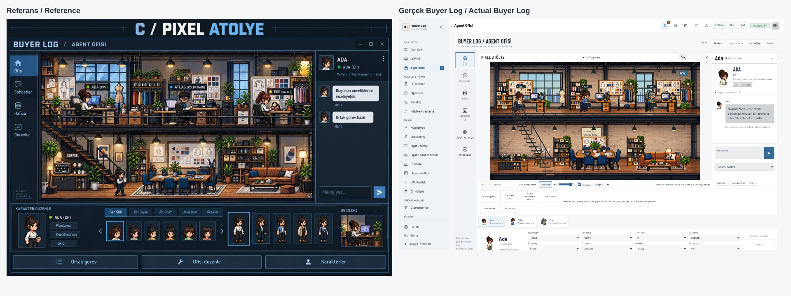

# Buyer Log Agent Ofisi / Agent Office

Agent Ofisi, Buyer Log'un tek LCW AI motorunun üzerinde kalıcı bağlam ve operasyonel karar desteği sağlar. Bu çalışma model ağırlıklarını değiştirmez: “eğitim”, sürümlü talimatlar, kullanıcı onaylı hafıza ve seçilerek getirilen geçmiş anlamına gelir. Outlook, ses ve PLM değişiklik modülü kapsam dışıdır.

## Kullanım / Usage

- Sol menü → Agent Ofisi. Ada (CP), Atlas (Koleksiyon), Ece (Kalite) başlangıç ekibidir. İsim, uzmanlık, çalışma alanı, talimat, saç, ten, kıyafet, aksesuar ve masa düzenlenebilir.
- Pixel Atölye, sabit yandan görünümde iki katlı, katmanlı 2D Canvas sahnesidir. Üstte üç çalışma masası; altta kahve köşesi, toplantı ve dinlenme alanı bulunur. Kamera dönmez; yakınlaştırma, kaydırma ve seçili agenta odaklama yalnız 2D görünümü değiştirir. Sahne açık/koyu temadan bağımsızdır; bütün dış kontroller, sohbet ve modallar mevcut Buyer Log tokenlarını kullanır.
- Karakterin saç modeli/rengi, ten tonu, üst türü/rengi, alt giyim, ayakkabı, gözlük ve aksesuarı canlı ön izlenir; Kaydet ile agenta özel kalıcılaşır. Eski avatar alanları taşınır. Müsait/iş bekliyor/inceleme/yanıt/hata göstergeleri gerçek iş ve hafıza kayıtlarından gelir. Boşta yürüyüş/kahve/dinlenme dekoratiftir; AI işi sayılmaz. Ortak gerçek iş sırasında katılımcılar toplantı noktasına yönelir. Sahnedeki konuşma işaretleri dekoratiftir; gerçek agent iletişimi Koordineli görev işinin kayıtlı adımlarında görünür. Hareket hedef hücreleri ve koltuk yerleri rezerve edilir; kopya agentlar ayrı yürünebilir konum alır.
- Ofis editörü nesne seçme, sürükleme, uygun nesneleri yatay çevirme, ekleme/kaldırma, geri al/yinele, kaydet/vazgeç ve en fazla altı düzen şablonu içerir. Yerleşim önce yerel taslaktır; açık Kaydet ile revizyon kontrollü özel depoya yazılır. Kat, tam eşya genişliği ve merdiven bağlantısı ortak istemci/sunucu modeliyle doğrulanır. Eski düzenler otomatik değiştirilmez; açık Atölye geçişi eski legacy koordinatlarını yedek olarak korur.
- Atmosfer cihazın yerel saatine göre sabah (06–11), öğle (11–17), akşam (17–21), gece (21–06) olur; manuel seçim, lamba açma/kapama ve ışık seviyesi saklanır. Pencere gökyüzü/şehir ışıkları, duvar/floor ortamı ve ayrı tavan/masa ışıkları katmanlıdır. LCW ve sabit marka vizyonu birer kez bulunur.
- Bir konu verin. Kullanıcı mesajı, AI yanıtı, kaynak referansları ve iş sonucu kalıcı arşive yazılır. Başarısız, geçersiz biçimli veya yarım AI yanıtları da doğrulanmamış olarak korunur. AI bağlantısı olmadan hafıza, arşiv, ofis ve deterministik analiz kullanılabilir.
- Hafıza → Talimat / bilgi ekle: tür, konu anahtarı, onay ve katalogda paylaşılabilirlik ayrı seçilir. Aynı anahtardaki farklı bilgiler çelişki olarak işaretlenir. Eski kaydı pasifleştirmek bağlamdan çıkarır; geçmiş sürümü korunur. Kopya hafızası yeni sahip onaylayana kadar normal bağlama girmez. AI hafıza adayını kendiliğinden onaylamaz.
- Koordineli görev: 2–4 agentın ayrı analizleri, isteğe bağlı karşılıklı inceleme turu ve ortak sonuç Buyer Log tarafından sırayla yürütülür. Önizleme 3–9 LCW AI çağrısını gösterir ve açık onay ister. Önceki gerçek yanıtlar kimlik, zaman, kaynak ve doğrulanmamış öneri etiketiyle aktarılır. Uzun yanıtlar açıkça işaretlenmiş alıntılarla sınırlanır; tam konuşma korunur. Her adım güncel IAM ve agent revizyonunu kontrol eder. Hata/iptalde kalan adımlar başlamaz; tamamlanmış sonuçlar arşivde kalır. Aynı LCW motoru bağımsız dış denetim sayılmaz.
- Ortak görev: en fazla dört agentın ilgili hafızası tek LCW AI çağrısında birleştirilir. Yanıtta katılımcılara ait ayrı bakışlar bulunur. Bunlar bağımsız incelemeler değildir. Kaynak sistem değişmez.
- Görevler → Veriyi değerlendir: sipariş/PLM/renk kapsamı, CP öncelikleri, kişisel CP kuralları, ASAS tarih farkları, onay/kanıt çelişkileri, test raporu eşleşmeleri, eksik kimlik ve şüpheli adetler, tekrar/çoklu eşleşmeler, üretici riskleri değerlendirilir. Önceki gerçek değerle yeni gerçek değer karşılaştırılır. Kaynak değişikliği tek başına çelişki değildir. Tam kapsam JSON raporu indirilebilir; LFL fiyat/üretici kıyasları aynı para birimi, sezon ve karşılaştırılabilir klasmanla mevcut fiyat motorundan hesaplanır. Üretici/sezon kalite paydası yalnız testli siparişleri sayar; koleksiyon durum/sezon ilerlemesi sipariş riskleriyle ilişkilendirilir. Gerçek varış tarihi bulunmadığında OTIF/gerçekleşmiş termin başarısı üretilmez. Sipariş kanıt kartları normalleştirilmiş BOM kapsamını ve checklist kaynaklarını gösterir.
- Konuyu takip et: değişiklik uyarısı veya yerel güne göre günlük özet. Kontroller AI çağırmaz; aynı bulgu tekrar bildirilmez. Menüde uyarı sayısı görünür. Buyer Log uygulaması açık olmalıdır; bu sistem kapanan uygulama yerine işletim sistemi servisi çalıştırmaz. Hafif bildirim döngüsü ofise hiç girmeden etkinleşir; sahne veya AI motoru erken yüklenmez. Asistan ayarları yerel saat dilimi, günlük özet saati, 2–30 dakika kontrol aralığı ve önem eşiğini saklar. İlk tarayıcı saat dilimi kaydedilir; sonraki cihazlar kaydedilmiş tercihi değiştirmez. Masaüstünde açık tercihle pencere kapatıldığında sistem tepsisi ve genel içerikli bildirimler kullanılabilir; Tepsiden Çıkış uygulamayı ve takibi durdurur.
- Doğal dil otomasyonu mevcut otomasyon dilini üretir. Mevcut parser/validator ve yetkili kaynakla önizlenir. Kullanıcı onayından sonra **kapalı taslak** oluşturulur; etkinleştirme mevcut Otomasyonlar ekranındadır. Ofisin üretilen rehberi ve doğrulayıcısı mevcut `SHOW_REPORT`, `OPEN_PAGE` ve `REFRESH_SOURCE` aksiyonlarını kabul eder. Yenileme mevcut otomasyon runtime/izin denetimine tabidir; kaynak iş verisine otomatik düzeltme veya yeni dış sistem aksiyonu eklenmez.
- Hafıza → Geçmişte ara: owner/agent kapsamındaki gerçek mesajlara AI çağırmadan erişir. Sonuç tam kaynak konuşmasını açar. Uzun geçmiş mesajından ilgili pencere sonraki bağlama alıntı, özgün karakter sayısı ve içerik parmak iziyle eklenir; tam arşiv değişmez.
- Kalite belgelerini incele: sipariş/PLM kapsamındaki mevcut, yetkili checklist/test raporu eklerini seçer. En fazla beş dosya ve dosya başına 19 MiB. Gerçek dosya adı/boyutu, yükleme sayısı ve bir analiz çağrısı önizlenir; onay exact SHA-256 dosya baytları ve güncel yetkiye bağlanır. Yalnız ortak LCW `askWithFiles` yolu kullanılır; client dosya yolu kabul edilmez. Rapor özeti veya AI yorumu otomatik onay değildir.
- Sohbetler → MD arşivi: gerçek UTF-8 boyutuyla, mesaj kimliği/tarihi/sınırı korunarak 19 MiB altında parçalanır. Normal soruda bütün dosya gönderilmez. Açıkça seçilen tam arşiv incelemesinde parça sayısı, boyutu, planlanan AI çağrısı ve kapsam parmak izi gösterilir; onay gerekir. Parçalar sırayla incelenir, gerektiğinde özetleri birleştirilir. Başlangıç parçası ve en fazla 15 parça seçilerek kapsam yeniden önizlenir; her grup ayrı onaylanır. Tek inceleme en fazla 16 çağrıdır (15 parça + gerekirse birleştirme). Sonraki parçalara aynı akışla devam edilir. Dosyanın yüklenmesi tamamının model tarafından okunduğunu kanıtlamaz.

## Paylaşım ve moderasyon / Sharing and moderation

Agent kataloğunda paylaşım açık önizleme/onay gerektirir. Talimatlar ve yalnız etkin, süresi dolmamış, onaylı ve paylaşılabilir hafıza yayınlanır. Özel sohbetler katalog paketine girmez. Kopyalama ve sembolik ödünç alma bağımsız yeni agent oluşturur; ücret, kaynak kullanıcının yetkisi veya veri erişimi devralınmaz. Paylaşımı kaldırma gelecekteki kopyaları durdurur; alınmış kopyalar bağımsızdır.

Özel eğitim, hafıza sürümleri ve bütün sohbetler genel peer-sync allowlist'ine eklenmez. Ayrı `BUYER_LOG_SYNC/agent-office/v1` kanalında AES-256-GCM şifrelemesi, RSA-OAEP anahtar sarma ve RSA/SHA-256 gönderen imzası kullanılır. Özel anahtar cihazda kalır; klasöre/token loguna gitmez.

**İlk cihaz eşleştirmesi:** Her taraf Sync'i çalıştırır. Sync cihazları ekranındaki SHA-256 parmak izi ilgili kişinin kendi Buyer Log ekranıyla karşılaştırılır ve doğrulanır. Gönderen alıcının, alıcı gönderenin anahtarını doğrulamalıdır. Ortak klasörde bir moderatör kimliği yazması güven oluşturmaz; doğrulanmamış anahtarlara özel arşiv gönderilmez ve doğrulanmamış gönderen içe alınmaz. IAM rol/aktiflik her erişimde kontrol edilir. Anahtar değişiminde yeniden doğrulama gerekir. Önceden yetkili cihaza teslim edilen veriyi rol kaldırıldığında geriye dönük silme iddiası yoktur.

Moderatör, kullanıcı seçerek Sync'ten tam eğitim/konuşma arşivini salt okunur inceler; okumalar, dışa aktarımlar ve birleştirmeler audit kaydı üretir. İlk aktarım için sahibin uygulaması/Sync'i ve karşılıklı doğrulama gerekir. Eğitim birleştirmesi tekrarları ayırır, aynı anahtar çelişkilerinde seçim ister, yeni moderatör agentına kaynak/soy bilgisiyle kaydeder. Otomatik veya API'de olmayan fine-tuning yapılmaz.

## Teknik uygulama / Technical implementation

- `server/lib/agent-office-store.js`: sahip başına ayrı dayanıklı veritabanı. `local-db.privateRecordTransaction` mevcut dosya kilidi/CAS ve fsync WAL yolunu yeniden kullanır; normal sync olayları oluşturmaz. Sıra numarası mesajla aynı işlemde artırılır. Özel veritabanının snapshot eşiği 32 MiB'dir; her mesajda tüm arşiv yeniden yazılmaz.
- `agent-office-intelligence.js`: canonical field mapping + CP/readiness + CP rule evaluator + checklist + test-report + sample-request motorları. Aynı PLM/renk için birden fazla kayıt saklanır; ilk eşleşme sessizce seçilmez. CP yoksa yetkili Orders/Backlog projeksiyonu canonical CP alanlarına çevrilir. Collection, yetkili LFL satırlarından toplu fiyat/üretici sonuçları ve PLM BOM kanıtları ayrıca bağlanır. Normal PLM Sync zaten getirilen BOM yanıtındaki tüm normalleştirilmiş bileşenleri saklar; ayrı ağ/AI çağrısı üretmez. Eski yalnız dekorasyon kayıtları sonraki normal Sync'e kadar eksik kapsam olarak kalır. Bileşen kanıtı API yanıtının desteklediği alanlarla sınırlıdır.
- `agent-office-workflow.js` / `agent-office-evidence.js`: sunucunun belirlediği sıralı adımlar ve yetkili ek seçimi; plan/byte/IAM önizleme onayı, gerçek alt iş bağlantıları, hata sonrası kalan adımların durması. Gerekli handoff/orchestration/ek bağlamı isteğe bağlı analytics ve geçmişten önce ayrılır; sığmayan gerekli kanıtta çağrı başlamaz.
- `agent-office-decision-support.js`: mevcut fiyat motoru kullanılır; yalnız açık aggregate DTO taşınır, ham LFL satırları/engine items kopyalanmaz. UI başına en fazla 100 üretici ve üretici başına sekiz klasman; atlanan sayılar bildirilir.
- `agent-office-notifications.js` / `electron/agent-office-background.js`: hafif global poll yalnız bildirim özeti alır; tam iş verisi taşınmaz. Sistem tepsisi opt-in ve dar, güvenilen sender kontrolü yapılan IPC kullanır.
- `agent-office-service.js`: seçili/onaylı hafıza, ilgili geçmiş, sınırlı gerçek kanıt ve gözlem farkları. Bağlam geçerli JSON olarak 17.800 karakter altında paketlenir; atlanan kayıt sayısı belirtilir. Kullanıcı başına iki eşzamanlı iş, 24 agent, 30 takip. Deterministik tarama bir dakika önbelleklenir; yetki profili anahtara dahildir. İki dakikalık arka plan döngüsü üst üste binmez.
- `agent-office-sync.js`: sahip/moderatör alıcı kapsamı, yerel anahtar sabitleme, imzalı şifreli artımlı paketler, immutable mesajlar, revision çelişkileri ve devam zinciri. Aktivasyonda alıcı başına en fazla 32 gönderim/alım paketi; değişmeyen kaynak revision tekrar hashlenmez. Genel Sync yetki sözleşmesi değişmez.
- `server/routes/agent-office-routes.js`: sahip sunucudaki oturumdan belirlenir; istemciden `ownerId` ile erişim yükseltilemez. Moderatör endpointleri ayrı gate kullanır. Akış kapatılınca AI işi iptal edilir. Kritik otomasyon önizlemesi uygulamadan önce yeniden doğrulanır.
- `public/agent-office*`: lazy yüklenen TR/EN arayüz, görünürlük kontrollü canvas, yerel saat ışığı, seçilen saç stiline göre üç karakter çizimi, gövde için önbellekli kıyafet/ten varyantları, kimlik nesli değişince istek yanıtlarını reddetme ve özel modal/önbellek temizleme.
- `lcwai-prompt.js`: `agent-office` sözleşmesi tek şirket motorunda. İş verisi, arşiv ve kopya kayıtları güvenilmez kanıttır; yetki veya çalıştırılabilir talimat sayılmaz.

## Performans ve veri sınırları / Performance and evidence limits

Deterministik tarama, uyarı ve ofis hareketi sıfır AI çağrısı yapar; kullanıcı tarafından gönderilen analiz/sohbet gerçek LCW AI çağrısıdır. Altı yerel PNG toplam yaklaşık 8,83 MiB'dır, yalnız ofise ilk girişte yüklenir; decode edilmiş atlaslar yaklaşık 36 MiB, sınırlı sprite/portre önbellekleri ve sahne katmanları ek bellek kullanır. WebGL/Three.js veya uzak görsel servisi bulunmaz. Sabit mimari/ışık yüzeyleri önbelleklenir. Hareketli/gerçek iş sırasında hedef üst sınır 24 FPS, boşta 8 FPS; ekonomik kipte en fazla 12 FPS. Gizli sekmede render durur; azaltılmış hareket yalnız değişiklikte çizer. Gerçek donanım FPS/GPU garantisi verilmez; headless Canvas çizim ölçümü masaüstü cihaz testi yerine geçmez.

Koordineli işler 3–9 analiz çağrısı; belge incelemesi seçilen 1–5 dosya yüklemesi + bir analizdir. Önizleme seçili dosyaları doğrulama/hash için okur; üst sınır ~95 MiB bellek + ortak upload overhead'ıdır. Toplu iş/ek/arşiv incelemesi onaysız başlamaz. 10.000 anonim LFL satırında yerel fiyat motoru örneği ~164 ms ve ~53 KB sınırlı aggregate çıktı verdi; bu fiziksel tüm sistem performans garantisi değildir. Büyük arşivin ilk Sync aktarımı, tüm arşivin isteğe bağlı AI incelemesi ve çok kullanıcılı moderatör arşivi maliyetlidir; UI kapsam/boyut/çağrı bütçesini gösterir. Arşivler kayıpsız tutulur; çok büyük arşivler için storage compaction/retention ve ayrı soğuk arşiv indekslemesi ayrıca kapasite çalışması gerektirir.

UI kaynak, gerekçe, zaman, güven ve bilinmeyen kapsamı taşır. Kullanıcı onayı kaynak raporunun doğruluğunu veya güncelliğini kendiliğinden kanıtlamaz. FOB kaynak para birimi doğrulanmadan ülkeler arası fiyat kıyası yapılmaz. AI tahmini, eski sohbet ve dosya özeti doğrulanmış sipariş verisi değildir.

English: Pixel Workshop is a layered, fixed-side-view two-floor Canvas scene. Six local PNG assets (~8.83 MiB, ~36 MiB decoded) load lazily; no 3D renderer or remote art service is used. Controls/chat/editors inherit the existing Buyer Log theme. Appearance, four time periods, lamp power and owner-specific layout persist through CAS. Office edits are explicit drafts with undo/redo and save/discard; shared footprint/stair validation runs in client and server. Legacy layouts survive explicit conversion in a normalized backup. Decorative idle movement makes no AI calls and never represents real work. Real job state drives indicators, completion reactions and shared-job gathering. Rendering targets 24 FPS during movement/jobs and 8 FPS idle, pauses while hidden and respects reduced motion; headless measurements are not desktop GPU guarantees. Durable memory is contextual learning, not model fine-tuning. Shared jobs support a low-cost single-call perspective mode and real sequential multi-step coordination with recorded handoffs, optional mutual review, synthesis and 3–9-call explicit approval. Authorized quality attachments use the existing common upload contract after exact-byte preview approval. Global proactive checks run without opening the scene; optional Electron tray mode keeps the existing application alive. Historical prices reuse the existing comparison engine and expose bounded aggregate DTOs, never raw unused rows. Copies inherit approved shared knowledge only, never permissions. Bulk archive review is explicit, bounded and cost-approved; uploading all parts does not prove complete model reading.

## İlk atölye iterasyonu kabulü / Initial workshop acceptance — 2026-10-10

- Agent Office + Workshop store: 26/26 hedefli test başarılı. Önceki backend regresyonları: 34 dosya/307 test ve ek 3 dosya/35 test başarılı. Tam suite bir kez denendi; sandbox yedekleme yolu `/tmp/codex-daemon-1000` nedeniyle tamamlanamadı. Bu, tam suite başarı sonucu değildir.
- Gerçek Chromium/anonim Buyer Log: 1920×1080, 1440×900, 1366×768; 16:9 sahne oranı, yatay taşma yok. Karakter tıklama/ajan sohbet seçimi, görünüm kaydı ve yeniden açma, sürükleme, geri al/yinele, açık ofis kaydı, şablon ekleme/silme/yükleme ve taslağı iptal doğrulandı.
- Dört atmosfer, manuel ışık/lamba tercihlerinin yeniden açılışta korunması, native açık/koyu tema, azaltılmış hareketin durması ve tekrar başlaması doğrulandı. Hareket testinde merdiven geçişi, kahve noktasına ulaşma ve yön değiştirme gözlendi. Konsol hatası, bozuk atlas veya boşta AI çağrısı yok.
- Ortak iş sahne testi gerçek sunucu iş şemasıyla test fixture kullanır: review/responding/completed durumları, iki katılımcının toplantı alanına ulaşması ve sabit 2D zoom sınırları başarılı. Bu test canlı LCW AI çağrısı değildir.
- Mevcut hafıza, deterministik analiz, katalog/ödünç alma, moderatör arşivi, otomasyon önizleme, rapor erişimi, büyük arşiv/cihaz doğrulama modalları, ortak görev ve TR/EN akışlarının gerçek tarayıcı kontrolü başarılı. LCW AI bağlantı hatasının arşivlenmesi sunucu testinde doğrulandı; kurumsal canlı oturum bu ortamda yok.
- Yaklaşık 26 saniyelik headless hareket örneğinde Canvas draw ortalaması ~0,61 ms. Bu yalnız draw süresidir; toplam CPU, GPU veya desteklenen fiziksel masaüstü donanımının FPS ölçümü değildir.
- Referansın iki katlı sabit atölye mimarisi, üst üç istasyon, soldaki merdiven/kahve, alt toplantı/dinlenme alanı ve pixel art yaklaşımı uygulanır. Yeni atlaslar özel üretimdir; mobilya ayrıntıları, karakter kareleri ve native kontroller referansın piksel piksel kopyası değildir. Sprite sistemi üç saç silueti, altı hareket pozu ve palet/ankraj varyantları içerir; tam oyun motoru/360° karakter sistemi iddiası yoktur.
- TR/EN bekçisi: sıfır yeni eksik. Pending release notes: 33 kayıt ve gerçek post-change PNG doğrulaması başarılı. GitHub CI quota politikası gereği workflow tetiklenmedi; TEST/STABLE yayımlanmadı.

## Tamamlama matrisi / Completion matrix

| İstek / Request | Uygulama ve sınırı / Implementation and limit |
| --- | --- |
| Sipariş, CP, ASAS, onay, BOM ve teslim bağları | Canonical veriler ve mevcut deterministik motorlar; BOM yalnız gerçekten alınan alanlar. Gerçek varış tarihi yoksa gerçekleşmiş teslim başarısı bilinmiyor. |
| Günlük kritik işler ve proaktif asistan | Ofisten bağımsız yetkili tarama, gerçek gözlem farkları, yerel günlük özet, önem eşiği, bildirim, opt-in tepsi; boşta sıfır AI çağrısı. |
| Kalite / onay / veri kalitesi | Test-checklist-PLM kapsam/eşleşme/kanıt çelişkileri; kullanıcı seçimiyle gerçek dosya incelemesi. Kaynak verisi otomatik düzeltilmez. |
| Üretici / koleksiyon karar desteği | Testli kalite paydası, sezon/durum ilerlemesi, sipariş risk bağı; mevcut LFL motoruyla para birimi ve klasman korunan fiyat kıyası. |
| Kalıcı adlı agent ve unutulmayan konuşma | Owner bazlı WAL/CAS, iki taraflı tam transcript, sürümlü/onaylı hafıza, kaynak arama, önceki/sonraki değer ve çelişki ayrımı. Model ağırlığı eğitilmez. |
| Agentlar arası gerçek iş | Ayrı kayıtlı LCW çağrıları, gerçek handoff, karşılıklı inceleme ve ortak sonuç; açık çağrı bütçesi/onay, her adımda güncel yetki. |
| 20 MB üzeri geçmiş | Mesaj sınırını koruyan <19 MiB MD parçaları; ayrı onaylı en fazla 15 parça + bir birleştirme; normal sohbet yalnız seçili bağlam taşır. |
| Kopyalama / sembolik kiralama / moderasyon | Onaylı paylaşılabilir eğitim kopyası, yetki devri yok; karşılıklı anahtar doğrulamalı şifreli Sync ve auditli moderatör incelemesi/seçilmiş eğitim birleştirme. |
| Türkçe / İngilizce analiz ve otomasyon | Tek şirket AI motoru + mevcut DSL/parser/validator/runtime. Onayla kapalı taslak; etkinleştirme mevcut ekran. API'de olmayan araç veya dış sistem değişikliği uydurulmaz. |
| Yaşayan düzenlenebilir Pixel Atölye | Gerçek katman/nesne/atlas/karakter; sabit iki katlı 2D sahne, merdiven, hedef rezervasyonu, kahve/dinlenme/iş tepkisi, görünüm ve düzen editörü, şablon/CAS, dört ayrı ışık atmosferi, zoom/focus. |
| Tema / güvenlik / performans | Sahnenin kendi kimliği + bütün kontrollerde mevcut Buyer Log token/TR+EN; owner/IAM kontrolü, gizli/azaltılmış hareket render durması, maliyetli iş önizlemesi. |
| Tasarım ve canlı kabul | Referansla aynı ana mimari/alan hiyerarşisi; özel sprite ayrıntıları birebir piksel kopyası değildir. Kurumsal canlı LCW oturumu, gerçek çok cihazlı şirket Sync ve fiziksel Electron/GPU son kabulü bu ortamda doğrulanamaz. |
| Hariç tutulanlar | Outlook, ses, PLM Change Intelligence, desteklenmeyen LCW fine-tuning/araçlar. TEST/STABLE yayını ayrıca istenmedikçe yapılmaz. |

## Tamamlama iterasyonu kabulü / Completion iteration acceptance — 2026-10-10

- Yeni koordinasyon/kanıt/asistan/tarihçe testleri: 9/9; karar desteği: 4/4; tepsi runtime: 1/1; atölye owner/CAS/24 ayrı konum: 6/6; BOM sync: 14/14.
- Tam regresyon bir kez başlatıldı. Durdurulan test grupları tekrar baştan koşulmadı; kalan gruplar birer kez tamamlandı. 910 test dosyasının bütün sekiz grubu çalıştırıldı. Yakalanan modül kaydı, küçük tipografi ve yinelenen navigasyon simgesi düzeltildi; ilgili kontroller yeniden geçti. Route-source sözleşmesi gerçek `app.use` middleware kaydını ve girintili endpointleri de sayar; aynı route kontrolü korunur. Yeni BOM regression fixture gerçek kumaş kategori kimlikleriyle düzeltildi. Geçici recovery testi beklediği, kalıtılan LOCAL_DATA_ROOT bulunmayan ortamda tekrar geçti; üretim recovery davranışı değiştirilmedi.
- Son ilgili regresyon grubu 139 kontrol içerir; bulunan tek simge hatasının ilgili 10 UI kontrolü düzeltme sonrası geçti. Route kayıt/enjeksiyon kontrolleri 53/53. İlk bütün gruplarda 66 koşullu ortam/platform testi atlandı; bu testlere başarı yazılmadı ve TEST/STABLE yayını yapılmadı. Kurumsal canlı oturum ve Windows kabulü ayrıca gereklidir.
- Gerçek Chromium: ofise girmeden global bildirim ve lazy scene; gerçek anonim PDF'nin mevcut parse/commit ile kaydı, yetkili seçim ve byte/çağrı önizlemesi; beş çağrılı koordinasyon planı AI çalıştırmadan; gerçek bağlantı hatasının kalıcı transcript/job kaydı; geçmiş araması ve kaynak konuşmasının açılması; yerel asistan ayarlarının yeniden açılışta korunması; BOM kartı ve gerçek DSL refresh önizlemesi; TR/EN ve sıfır konsol hatası doğrulandı.
- Son ekranlarda 1920×1080, 1440×900 ve 1366×768 oranları 16:9; yatay taşma yok. Native kontrollerin en küçük metni 10px. Açık/koyu ekranlar ve aşağıdaki referans/gerçek ekran karşılaştırması yeniden alındı. Önceki tam editor/görünüm/ışık/motion kabulü bu iterasyonda da geçti. Yeni hedef rezervasyonuyla ortak işin iki katılımcısı merdivenden geçerek toplantıya ulaştı; status review/responding/completed ve zoom sınırı doğrulandı. Ortak iş scene testi açık test fixture kullanır, canlı LCW sonucu değildir.
- 41 pending sürüm notu ve sekiz yeni gerçek uygulama PNG'si doğrulandı; TR/EN bekçisinde sıfır eksik. Sahne draw ölçümü headless ölçümdür; fiziksel CPU/GPU veya Windows tepsi kabulü tamamlandı sayılmaz.
- Referans hedefin iki katı, üç üst çalışma istasyonu, sol merdiven/kahve, alt toplantı/dinlenme, sağ agent sohbeti ve alt kişiselleştirme alanı korunur. Native tema kontrol tipleri ve responsive panel oranları Buyer Log'a uyarlanır. Özel atlasların mobilya ayrıntısı ve saç/giysi varyantları referansın piksel piksel aynısı değildir; yüzde 100 görsel eşleşme iddiası yapılmaz.

English: All eight groups covering 910 test files were exercised through one full-suite attempt and continuation of previously unrun batches. Detected failures were corrected and checked in the affected tests; 66 conditional environment/platform skips remain explicitly unverified. New workflow/evidence/assistant/history tests pass 9/9, decision support 4/4, tray runtime 1/1, workshop persistence 6/6 and BOM sync 14/14. Real-browser acceptance verifies authorized PDF import/selection/cost preview, coordination plans with zero preview AI calls, genuine offline failure preservation, source history search, local settings persistence, normalized BOM cards, controlled source-refresh preview, language/theme/resolution behavior and zero console errors. Corporate LCW authentication, actual company multi-device Sync and physical Windows/Electron/GPU acceptance are unavailable here. No TEST/STABLE release is triggered.

Güncel ek kabul, görsel farklar ve gerçek Windows/kurumsal ortam gereksinimleri: [Final acceptance](AGENT_OFFICE_FINAL_ACCEPTANCE.md).
