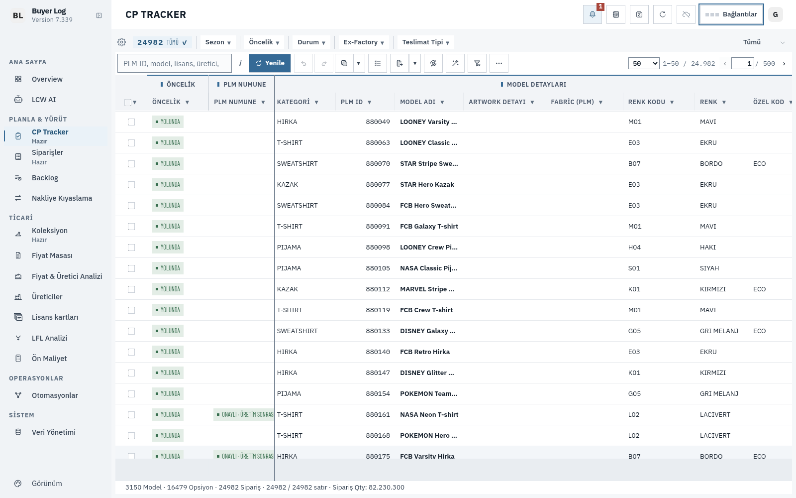

# Ortak UI katmanları — ölçüm ve regresyon

Kaynak inceleme: [2026-11-05 bulguları](2026-11-05-codex-review-findings.md).
Karşılaştırma tabanı: `63159fb3` (main; görev sırasında gelen Faz 5 entegrasyonu dahil). TEST/STABLE yayını ve merge bu görevin kapsamında değil.

## Kapsam ve kararlar

| Madde | Karar | Kanıt ve uygulama |
| --- | --- | --- |
| SHELL-07 / i18n-runtime | **Atlandı** | 30k fixture üzerindeki kaydırma/modal/modül geçişlerinde toplam yaklaşık 9 ms; aktif renderer örneklerinin yaklaşık %0,1'i. Kare bazında kök birleştirme denemesi anlamlı kazanç göstermedi ve geri alındı. Belge genelindeki bekçi, senkron dil değişimi ve hidden UI kapsamı korunuyor. |
| SHELL-08 / table-header-tracking | **Uygulandı** | Başlıklar hazırlanır; bütün geometri okunur; ardından yalnız değişen visibility/maxWidth/transform yazılır. rAF tekilleştirmesi ve freeze-pane sınır hesabı korunur. Chrome'un normalize ettiği transform biçimiyle karşılaştırılır. Etiket hazırlığı sonrası gerçek grup bandı yüksekliği de aynı okuma fazında ölçülür ve sticky sütun satırına uygulanır. Motion+ değişmedi. |
| INT-08 / model-image-cache | **Atlandı** | Fixture'da görünen 100 img öğesinin data-src değeri boş; bunlar 120×150 placeholder. Orijinal model görseli/decode yükü yok. Ölçüm, preview üretimini gerekçelendirmiyor. Normalizasyon/kimlik çözümleme örnekleri preview kazancı sayılmadı. 96/192/384 px kalite karşılaştırması veya decoded-memory kazancı iddia edilmiyor. |
| workspace-blur | **Uygulandı** | Başlangıçta kapalı/gizli yüzeyler de kaydedilir. Eklenen alt ağaçlardan yeni yüzeyler bulunur; kopanlar bırakılır. Yüzeyleri, atalarını veya rail'i etkilemeyen class/style değişimleri geometri/stil taraması başlatmaz. Gerçek açık yüzey seçicileri ve tek blur katmanı korunur. |

Bu PR’ın diff’inde `i18n-runtime.js`, `model-image-cache.js`, `motion-plus.js` ve görevde dokunulmaması istenen dosyalarda değişiklik yok. Main entegrasyonu bu dosyalara görev kaynaklı bir değişiklik eklemedi.

## Düzenek

- Sentetik arşiv: `docs/performance-program/fixtures/source-30000-seed7-20261105.tar.gz`; SHA-256 `5913414603984b02b1c30b87f1f9231da3718ab797a007f4bd14067ec6cd5c70`.
- Arşiv `/tmp/buyerlog-startup-shared-ui/source/` altına açıldı. Mevcut startup ölçüm aracıyla ayrı `/tmp/buyerlog-startup-shared-ui-main/` kökünde refresh/cache üretildi; kaynak dosyalarının checksum'ları doğrulandı. 30.000 Orders, CP filtresi sonrası 24.982 CP kaydı; sayfa başına 50 satır. Sanal olarak 30k DOM satırı üretilmedi.
- Gerçek Linux Chromium, Playwright, 1600×1000 viewport, normal motion. Startup ve arka plan hazırlığı bittikten sonra ölçüldü. Aynı sunucu/cache generation, her koşuda yeni ve izole tarayıcı context'i. Harici HTTPS istekleri engellendi. UI tercihleri GET için boş fixture olarak verilir; tercih yazımları context dışına taşınmaz. Her koşunun TR/standard/0 freeze başladığı assert edilir. İş verisi, modal ve render yolları gerçek uygulamadır; tercih senkronizasyonu bu ölçümün kapsamı dışındadır.
- `before-1 → after-1 → before-2 → after-2 → before-3 → after-3`. Önce/sonra script baytları başlangıçta sabitlendi; hash'ler JSON'da. Her koşuda CP kaydırma, CP not penceresi aç/kapat, Orders'a geçiş, Orders kaydırma, Orders not penceresi aç/kapat, CP'ye dönüş.
- Kaydırmada 70 rAF adımı; yatay 0→2380→0 px, dikey 0→1020→0 px. Frame quantile'ları ardışık rAF aralıklarından (ilk başlangıç örneği hariç). Kullanıcı donanımındaki wheel/trackpad ölçümü olduğu iddia edilmez.
- CDP Profiler 500 µs örnekleme ve eşzamanlı Chrome timeline trace. `inclusiveMs`, fonksiyonun alt çağrıları/native DOM/layout dahil örneklenen süresidir; kendi JS CPU süresi JSON'da ayrıca tutulur. İmzalı CDP timeDeltas zaman damgasına çevrilip sıralanır. Timeline Layout ve UpdateLayoutTree süreleri ayrı raporlanır; iç içe olaylar toplanıp toplam CPU diye sunulmaz.

## Sonuçlar

[Nihai ölçüm JSON'u](2026-11-07-shared-ui/measurement.json.gz), [özet](2026-11-07-shared-ui/summary.json) ve [ham trace/profiller](2026-11-07-shared-ui/traces/). Chromium **154.0.8037.57**, AMD EPYC 9V74, 4 CPU kotası, 16 GiB bellek sınırı.

Altı etkileşimin toplamı; alt çağrılar dahil örneklenen ms:

| Fonksiyon dosyası | Önce 1 / 2 / 3 | Sonra 1 / 2 / 3 | Medyan önce → sonra |
| --- | --- | --- | --- |
| table-header-tracking | 938,5 / 926,9 / 1156,7 | 23,9 / 20,0 / 20,9 | **938,5 → 20,9** (%97,8 azalma) |
| workspace-blur | 924,3 / 898,3 / 961,0 | 10,3 / 11,5 / 15,2 | **924,3 → 11,5** (%98,8 azalma) |
| i18n-runtime (aynı baytlar) | 8,7 / 8,5 / 19,7 | 9,8 / 9,6 / 9,4 | 8,7 → 9,6; değişiklik yok |
| model-image-cache (aynı baytlar) | 0,6 / 0 / 1,2 | 0 / 0 / 0,6 | Örnekleme sınırında kimlik yardımcıları; orijinal decode yok |

| Timeline / kare metriği | Medyan önce → sonra |
| --- | --- |
| Layout toplam süresi | 1291,2 → 993,7 ms |
| Layout olay sayısı | 312 → 187 |
| UpdateLayoutTree toplam süresi | 697,8 → 686,2 ms |
| FunctionCall toplam süresi | 3022,2 → 1164,2 ms |
| CP scroll p95 rAF aralığı | 66,7 → 50,1 ms |
| Orders scroll p95 rAF aralığı | 66,7 → 50,0 ms |

İki iyileştirme aynı adayda ölçüldü; bağımsız ablation yapılmadı. Oranlar ilgili fonksiyonların örneklenen sürelerine aittir. Kalan yaklaşık 50 ms p95, diğer render işinin sürdüğünü gösterir. Her fazın kendi profili ve timeline özeti JSON'da bulunur.

## RED → GREEN ve tarayıcı korumaları

Yeni testler aynı baseline script'leriyle izole temp dizinde çalıştırıldı: başlık read/write sırası ve ilgisiz blur mutation bütçesi olmak üzere iki beklenen RED. Adayda yedi test GREEN. Sticky ofset için ek RED de sabitlendi: 33 px bandın altında 25 px olarak kalan ofset ölçülen yüksekliğe eşitlenir. Kaynak sözleşmesi testleri gevşetilmedi.

Gerçek Buyer Log'da [Tarayıcı kabul JSON’u](2026-11-07-shared-ui/browser/acceptance.json.gz) ve [piksel karşılaştırması](2026-11-07-shared-ui/browser/visual-diff.json): TR/EN × CP/Orders × compact/large × 0/3/9 freeze sütunu; 320 px freeze pane ve 700 px yatay kaydırma kontrolü. Başlık/gövde konumları ve label visibility/maxWidth/transform değerleri doğrulanır. Aynı scroll konumundaki tekrar olayında gerçek DOM'da grup etiketi style mutation sayısı da ölçülür. Freeze kontrolünde setFreeze → freezeRefreshTable → BLFlushTableRenders yolu kullanılır; böylece grup başlıkları gerçek UI gibi freeze sınırında yeniden bölünür. Ölçek, freeze ve scroll adımları ayrı karelerde tamamlanır. Modal aç/kapat, nested native dialog, rail ve reduced-motion kontrol edilir. Önce/sonra sekiz PNG çifti incelendi. Farklar yalnız başlık bandında (ve modal görselindeki blur yayılımında): Gerçek freeze yeniden çiziminden sonra baseline büyük ölçekte dört durumda da 36 px banda karşılık 34 px sticky ofset tutuyordu; adayda dört durumda da 36 px. Tablo gövdesi ve geri kalan arayüz piksel düzeyinde aynı. Bu bir hizalama düzeltmesidir; piksel eşitliği iddia edilmiyor. Ölçek testleri gerçek applyUiFontStep API’sini kullanır; density/resize yolu da çalışır. MaxWidth/transform için floor/round/subpixel sınırında en fazla 1 px, freeze başlık/gövde hizasında en fazla 1 px tolerans vardır; sticky top değeri grup offsetHeight değerine tam eşit olmalıdır.

Dinamik buton/tooltip, gizli UI, textarea, data-no-i18n ve tbody veri hücresi üzerinde i18n bekçisi ve dil geri dönüşü doğrulanır. Ayrıca sentetik 512×256 PNG için table bind, original preload ve clipboard byte eşitliği kontrol edilir. Fixture'da orijinal model görseli olmadığı için gerçek model zoom/preview kalitesine ilişkin yeni bir iddia yoktur; üretim image-cache yolu değişmemiştir.

- İlgili testler: **34 dosya, 202/202 PASS**; yeni iş bütçesi/sticky/blur testleri **7/7 GREEN**, aynı testler baseline script'leriyle **3 RED / 4 PASS**.
- `npm run i18n:check`: yeni eksik 0, baseline 0. `npm run release:notes:validate`: 39 kayıt geçerli; TR/EN not ve gerçek post-change PNG eklendi.
- Tam `npm test`: 1290 dosyalık koşucu üçüncü batch'te `local-iam-migration-authority.test.js:18` yüzünden durdu (`undefined` yerine `IAM_LOCAL_INVALID` bekleniyor). Temiz, detached **63159fb3** worktree'sinde aynı hata yeniden üretildi. Sunucu/yetki kodu kapsam dışında bırakıldı.
- Kalan batch 4–10, resmi koşucunun ürettiği **aynı dosya listeleriyle** ayrıca yürütüldü; assertion/skip/deadline değiştirilmedi. İlk üç batch concurrency=4, kalanlar tarayıcı kontrolüne bir CPU bırakmak için concurrency=3. Toplam **8913 test: 8847 PASS, 1 baseline FAIL, 65 mevcut SKIP**. Kalan batch'lerin tamamı geçti. [Tam günlük](2026-11-07-shared-ui/tests/full-npm-test.log.gz), [devam günlüğü](2026-11-07-shared-ui/tests/remaining-batches.log.gz), [dosya listeleri](2026-11-07-shared-ui/tests/remaining-batches.json), [temiz baseline kanıtı](2026-11-07-shared-ui/tests/baseline-main-tests.log.gz).
- Kullanıcının belirttiği v714 hatası, görev sırasında main'e gelen #894 düzeltmesiyle geçti; bu PR v714 testini değiştirmiyor. Temiz baseline kontrolünde v714 9/9 PASS.
- Gerçek tarayıcıdaki ortak blur kabulü: **15 ekran, 95 gölge kuralı, 209 render denetimi PASS**; TR/EN × iki tema × dört boyut × GPU/software; rail hover/klavye, notes modal, nested native dialog, pinned rail, reduced/off/normal motion ve tekrarlı kapama.

Tam test paketi yeşil değil; PR taslak olarak açılır. Merge, TEST ve STABLE çalıştırılmadı.

## Tekrar çalıştırma

`resources/app` içinden; yeni temp kökler kullanın:

```sh
mkdir -p /tmp/buyerlog-startup-ui-fixture/source
tar -xzf ../../docs/performance-program/fixtures/source-30000-seed7-20261105.tar.gz -C /tmp/buyerlog-startup-ui-fixture/source
CHROMIUM_PATH=/usr/bin/chromium node scripts/benchmark-startup-orders.js --rows 30000 --source-fixture /tmp/buyerlog-startup-ui-fixture/source --fixture-root /tmp/buyerlog-startup-ui-server --skip-same-tab --module cp --out /tmp/buyerlog-startup-ui-fixture/startup.json
node scripts/benchmark-shared-ui.js --startup /tmp/buyerlog-startup-ui-fixture/startup.json --baseline 63159fb3 --out /tmp/shared-ui-measurement --variants before,after --runs 3 --visual-checks
node scripts/benchmark-shared-ui.js --startup /tmp/buyerlog-startup-ui-fixture/startup.json --baseline 63159fb3 --out /tmp/shared-ui-visual --variants before,after --runs 1 --checks-only
```

Profil/trace `.gz` dosyaları gzip açıldıktan sonra Chrome DevTools Performance/JavaScript Profiler ile okunabilir. Ekran görüntüleri sentetik veridir. Windows/Electron, soğuk OS cache, gerçek büyük model görselleri ve tüm modüllerin üretim verisi bu deneyin kapsamında ölçülmedi.

Gerçek post-change örneği (demo CP, üç sütun freeze):


